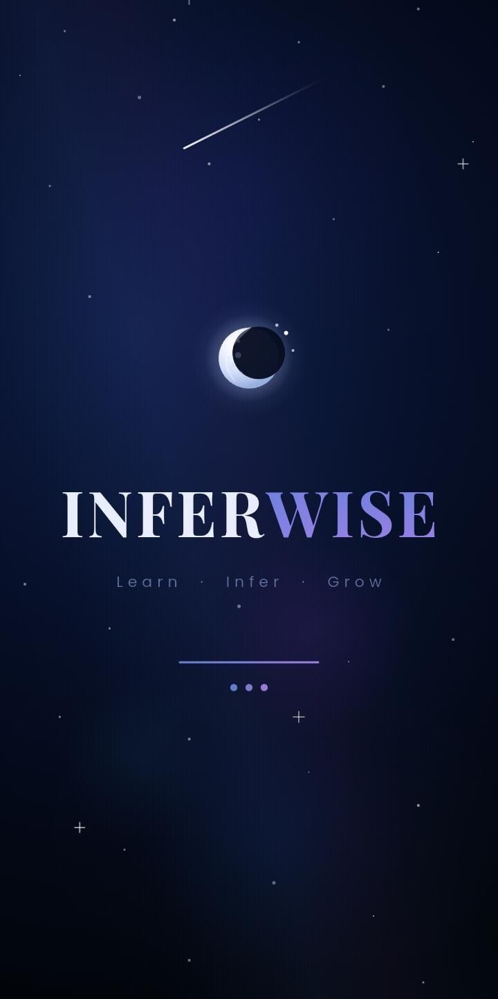
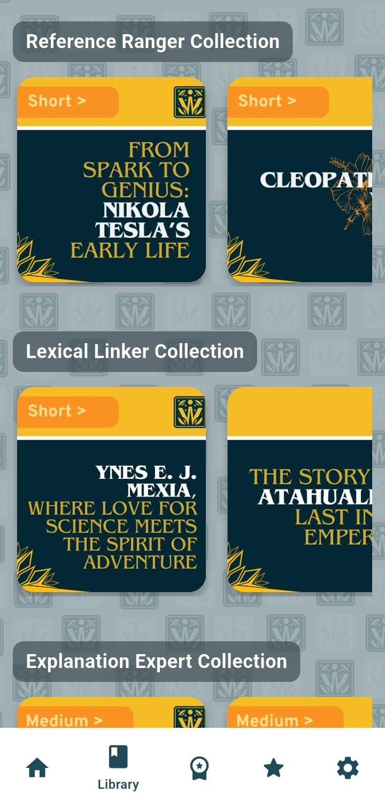
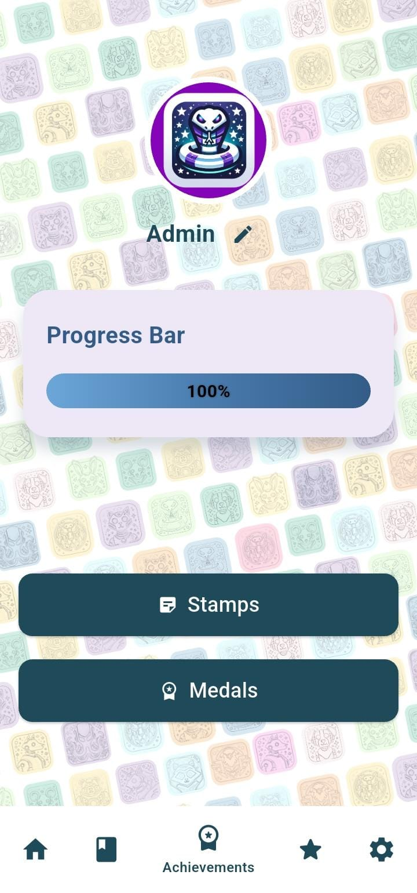
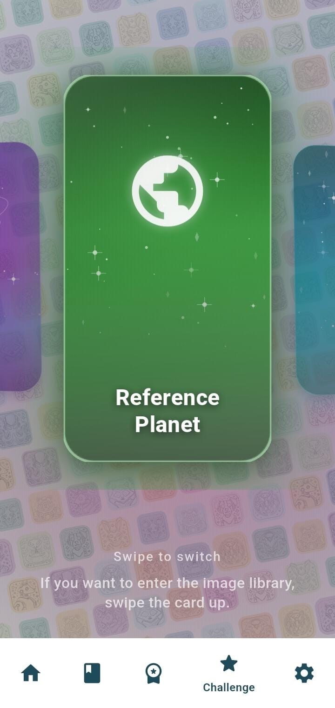

<div align="center">


# INFERWISE

### Learn · Infer · Grow

**Aprende a leer entre líneas en inglés.**
Aplicación móvil de comprensión lectora (B1–B2) basada en el desarrollo de habilidades de inferencia.

<br/>


<br/>

[Sobre el proyecto](#sobre-el-proyecto) ·
[Capturas](#capturas-de-pantalla) ·
[Características](#características) ·
[Metodología](#metodología) ·
[Tecnologías](#tecnologías) ·
[Instalación](#instalación) ·
[Roadmap](#roadmap)

</div>

---

## Sobre el proyecto

**Inferwise** es una aplicación educativa de inglés de nivel **B1–B2**, enfocada en la **comprensión lectora mediante el desarrollo de habilidades de inferencia**.

Entender un texto no consiste solo en reconocer lo que dice, sino también lo que sugiere. A través de textos seleccionados y actividades interactivas, Inferwise ayuda al usuario a:

- Identificar **información implícita**.
- **Deducir significados** a partir del contexto.
- Comprender el **contexto y el mensaje** de un texto en inglés.

Todo dentro de una experiencia visual y gamificada, con niveles progresivos, retos, sellos y medallas que sostienen la motivación del estudiante.

## Capturas de pantalla

<div align="center">

<table>
  <tr>
    <td align="center"></td>
    <td align="center"></td>
    <td align="center"></td>
    <td align="center"></td>
  </tr>
  <tr>
    <td align="center"><b>Inicio</b><br/><sub>Bienvenida y acceso</sub></td>
    <td align="center"><b>Biblioteca</b><br/><sub>Lecturas por colección</sub></td>
    <td align="center"><b>Panel</b><br/><sub>Perfil, progreso y logros</sub></td>
    <td align="center"><b>Retos</b><br/><sub>Planetas por tipo de inferencia</sub></td>
  </tr>
</table>

</div>

## Características

| Módulo | Descripción |
|---|---|
| **Cinco niveles progresivos** | Cada nivel incluye instrucciones, animaciones explicativas y práctica guiada. |
| **Biblioteca de lecturas** | Biografías, cuentos, noticias y artículos (15 de cada tipo), organizados en colecciones *Short* y *Medium*. |
| **Retos por tipo de inferencia** | Cinco categorías de actividades visuales, cada una con 4 retos. |
| **Ruta de aprendizaje** | Recorrido (*Pathway*) con puntos de control por nivel y un test final. |
| **Autoevaluaciones** | Evaluaciones por nivel con historial de resultados. |
| **Gamificación** | Barra de progreso, sellos por lectura completada, 10 medallas y animaciones de celebración. |
| **Cuentas y perfil** | Registro, inicio de sesión, nombre y avatar personalizables (12 ilustraciones). |

## Metodología

Inferwise trabaja cinco tipos de inferencia, cada uno con su propia colección de retos:

| Tipo | Qué entrena |
|---|---|
| **Referential** | Identificar a qué o a quién se refieren pronombres y expresiones dentro del texto. |
| **Lexical** | Deducir el significado de palabras desconocidas a partir del contexto. |
| **Explanatory** | Entender causas y razones que el texto no explica de forma directa. |
| **Elaborative / Associative** | Conectar el texto con conocimiento previo para completar su sentido. |
| **Predictive** | Anticipar lo que sucederá a partir de las pistas disponibles. |

## Medallas

<div align="center">

| | | | | |
|:---:|:---:|:---:|:---:|:---:|
| <br/><sub>Referential Ranger</sub> | <br/><sub>Lexical Linker</sub> | <br/><sub>Explanation Expert</sub> | <br/><sub>Associative Architect</sub> | <br/><sub>Prediction Pioneer</sub> |
| <br/><sub>Infera Champion</sub> | <br/><sub>Lifetime Teller</sub> | <br/><sub>News Nexus</sub> | <br/><sub>Narrative Master</sub> | <br/><sub>Scholar Star</sub> |

</div>

## Tecnologías

| Área | Herramientas |
|---|---|
| **Framework** | Flutter · Dart `^3.6.0` |
| **Estado** | `flutter_riverpod` |
| **Backend** | Firebase Authentication · Cloud Firestore |
| **Datos locales** | `sqflite` · `shared_preferences` · `path_provider` |
| **UI y animación** | `animate_do` · `flutter_animate` · `lottie` · `confetti` · `animations` · `flutter_staggered_animations` · `flutter_flip_card` · `page_flip_builder` |
| **Diseño** | `google_fonts` · `font_awesome_flutter` |
| **Utilidades** | `image_picker` · `file_picker` · `url_launcher` · `crypto` · `intl` · `logger` |
| **Calidad** | `flutter_lints` · `flutter_test` |

## Estructura del proyecto

<details>
<summary><b>Ver estructura de carpetas</b></summary>

<br/>

```
inferwise/
├── android/ ios/ web/ windows/ linux/ macos/   # Plataformas de Flutter
├── assets/
│   ├── Articles Stamps/ Biography Stamps/ News Stamps/ Stories Stamps/
│   ├── Banners/  covers/  Medals/  PUZZLES/  Wallpapers/  Photos/
│   ├── User Profile Illustrations/             # Avatares de perfil
│   ├── Imagenes de ejemplos/                   # Imágenes por nivel (1–5)
│   └── texts/                                  # Lecturas (.txt)
├── lib/
│   ├── main.dart
│   ├── screens/                                # Login, registro, home, splash, sesión, base de datos
│   ├── Self Assessments/                       # Autoevaluaciones por nivel e historial
│   └── Spots/
│       ├── Achievements/                       # Perfil, sellos y medallas
│       ├── Challenges/                         # Retos por tipo de inferencia
│       ├── Final-Test/                         # Test final
│       ├── IntuctionSpots/                     # Instrucciones y animaciones (Level 1–5)
│       ├── Library/                            # Biblioteca, lector y quizzes
│       ├── Pathway/                            # Ruta de aprendizaje
│       ├── ReadingSpots/                       # Blue, Dark Blue, Green, Orange, Purple
│       └── Settings/                           # Configuración
├── test/
└── pubspec.yaml
```

</details>

## Instalación

### Requisitos previos

- [Flutter SDK](https://docs.flutter.dev/get-started/install) compatible con Dart `^3.6.0`
- Android Studio o VS Code con las extensiones de Flutter y Dart
- Un emulador o dispositivo físico
- Un proyecto de [Firebase](https://console.firebase.google.com/) con **Authentication** y **Cloud Firestore** habilitados

### Puesta en marcha

```bash
# 1. Clonar el repositorio
git clone https://github.com/King1962774/Inferwise.git
cd Inferwise

# 2. Instalar dependencias
flutter pub get

# 3. Ejecutar la aplicación
flutter run
```

### Comandos útiles

```bash
flutter build apk --release          # Generar APK de Android
dart run flutter_launcher_icons      # Regenerar el ícono de la aplicación
flutter test                         # Ejecutar pruebas
```

### Configuración de Firebase

La aplicación se conecta a Firebase mediante `android/app/google-services.json`. Para usar un proyecto propio, descarga ese archivo desde la consola de Firebase y reemplázalo.

## Roadmap

- [x] Sistema de 5 niveles con instrucciones y animaciones
- [x] Biblioteca con 4 tipos de texto y quizzes por lectura
- [x] Retos por tipo de inferencia
- [x] Sellos, medallas y perfil de usuario
- [x] Autoevaluaciones e historial
- [x] Más lecturas y colecciones por nivel
- [x] Nuevos tipos de actividades de inferencia
- [ ] Publicación en Google Play y App Store

## Créditos y fuentes

- **Textos de lectura**: obras de dominio público y artículos de divulgación utilizados con fines educativos. Los derechos de cada texto pertenecen a sus autores y fuentes originales.
- **Ilustraciones, sellos, portadas, banners y medallas**: diseño propio del proyecto.

## Licencia

Proyecto privado. Todos los derechos reservados © 2026 King1962774.

## Autor

**King1962774**
GitHub: [@King1962774](https://github.com/King1962774)

---

<div align="center">

**Inferwise** · *Learn · Infer · Grow*

</div>